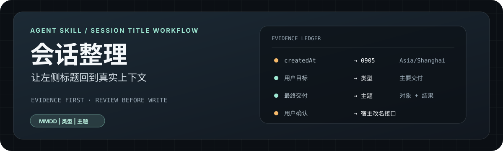
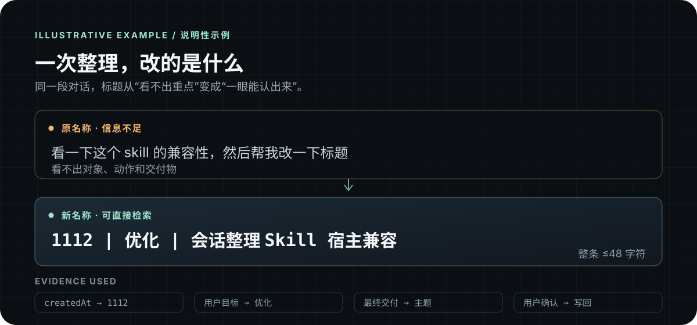

<p align="center">
  
</p>

<p align="center">
  <strong>让每一个会话标题都能被扫到、被找回来。</strong>
</p>

<p align="center">
  <code>MMDD | 类型 | 主题</code>
</p>

## 它解决什么

和 Agent 聊上几天，侧边栏就会堆满「继续修改」「看一下这个…」「新功能讨论」。生成当天还看得懂，一周后就是噪音。

**会话整理**读取每个会话的真实目标和最终交付，把标题压成一行：`1112 | 优化 | 会话整理 Skill 宿主兼容`。

它只改标题——不动对话正文、项目名称、项目归属、排序、置顶和归档状态。

## 前后对比

| 原来的标题 | 整理后 |
| --- | --- |
| 继续修改 | `0813 \| 修复 \| 登录页表单重复提交` |
| 看一下这个 skill 的兼容性，然后帮我改一下标题 | `1112 \| 优化 \| 会话整理 Skill 宿主兼容` |
| 新功能讨论 | `0901 \| 设计 \| 界面对齐检查` |
| 帮我看看这个报错 | `0820 \| 修复 \| 邮件回调鉴权失败` |

日期取自会话的 `createdAt`，不是整理当天。

## 一次整理改了什么

<p align="center">
  
</p>

标题不是猜出来的：先看用户真正要什么，再看最后交付了什么，最后才落到类型和主题。旧标题和助手的中途计划只能辅助定位。

## 支持的宿主

Skill 不绑定任何一家 Agent。协议只有三件事：**列会话、读内容、改标题**。宿主提供几项，就用几项。

| 宿主 | 状态 | 能做到 |
| --- | --- | --- |
| Codex app | 已验证 | 列任务、读内容、按任务 ID 改名 |
| Cindy（Pi 内核） | 已验证 | 列会话、摘要与原文、单条与批量改名 |
| Claude Code | 按宿主接口 | 暴露了会话接口就整理；没有就只给标题文本 |
| DeepSeek Harness | 按宿主接口 | 同上 |
| 其他 Agent Skills 宿主 | 自动探测 | 按下面的三档降级 |

| 档 | 宿主具备 | 结果 |
| --- | --- | --- |
| A 全自动 | 列 + 读 + 改 | 任意范围整理、预览、写回、读回核对 |
| B 半自动 | 只有改名，或只能改当前会话 | 整理当前会话；贴内容 → 出标题 → 确认后改名 |
| C 纯命名 | 都没有 | 读当前对话本身，给标题文本，自己粘贴 |

探测不到就明说，不会假装改过。找不到会话接口时，它依然能给你一个能直接用的标题。

## 安装

把仓库放进宿主的 skills 目录，**保留目录名 `session-title-organizer`**。

```bash
# 多数支持 Agent Skills 的宿主（Cindy / Pi / Claude Code 等）
git clone https://github.com/shrekcg/session-title-organizer.git \
  ~/.agents/skills/session-title-organizer

# Codex app
git clone https://github.com/shrekcg/session-title-organizer.git \
  ~/.codex/skills/session-title-organizer
```

| 宿主 | 默认目录 |
| --- | --- |
| Codex app | `~/.codex/skills/`（较新版本也会读 `~/.agents/skills/`） |
| Claude Code | `~/.claude/skills/` |
| Cindy / Pi / 其他 Agent Skills 宿主 | `~/.agents/skills/` |

Windows 把 `~` 换成 `%USERPROFILE%`。已经装过就 `git pull` 更新。

## 使用

调用入口随宿主：Skill 选择器、`/skill:session-title-organizer` 或 `$session-title-organizer`。

```text
/skill:session-title-organizer
# 不带范围 = 整理当前会话

/skill:session-title-organizer 整理「个人网站」项目
/skill:session-title-organizer 整理最近 20 个会话
/skill:session-title-organizer 解释这个标题的判断依据
```

**范围**：当前会话（默认）、你点名的某一条、某个项目、某个本地目录、截图里能看到的那几条、全部会话。不扩大你没说过的范围。

**确认**：

| 实际修改数量 | 行为 |
| --- | --- |
| 1 个已确定目标 | 判断后直接改，不打断你 |
| 2 个及以上 | 先给一张预览表，确认后才写 |
| 目标不唯一 / 结果集不完整 | 先问或停下，不猜 |

批量预览长这样：

| 原名称 | 新名称 |
| --- | --- |
| 继续修改 | `0813 \| 修复 \| 登录页表单重复提交` |
| 新功能讨论 | `0901 \| 设计 \| 界面对齐检查` |
| 目标不明的会话 | 保持原名 |

## 标题规则

```text
MMDD | 类型 | 主题
```

- **日期**：`createdAt` 按 `Asia/Shanghai` 转成四位月日；没有才用 `updatedAt`；都没有就用当天并注明。不因最近活跃而改日期。
- **长度**：整条 ≤48 字符，中文主题建议 10~26 字；超长删修饰词，不截断词、不缩写产品名。
- **主题**：`对象 + 动作/结果`。保留有辨识度的对象、页面、问题或交付物；不重复项目名；不照抄长请求。
- **语言**：跟着会话主语言走，按用户自己的表达判断；助手回复、代码、日志、引用不计入。单句外语不触发切换，产品名保留原文。

| 中文 | 英文 | 用在 |
| --- | --- | --- |
| 功能 | Feature | 新能力、新页面、新脚本 |
| 设计 | Design | 视觉、布局、交互方案 |
| 修复 | Fix | 缺陷、报错、异常行为 |
| 优化 | Improve | 性能、结构、体验改进 |
| 发布 | Release | 上线、部署、对外交付 |
| 探索 | Explore | 试方案、验证可行性 |
| 文档 | Doc | 规则、说明、资料整理 |
| 研究 | Research | 调研、对比、选型 |

不写入标题的内容：emoji、换行、Markdown、引号、绝对路径、邮箱电话密钥、「今日 / 刚才」这类相对时间。

## 它怎么判断

- **先判 `keep` 还是 `rename`**：原标题格式、日期、类型、主线、长度都成立就一字不改。
- **证据顺序**：用户真实目标 → 最终交付 → 项目上下文。旧标题只用来定位。
- **项目主题 ≠ 任务主题**：标题写这个会话在做什么，不重复项目名，也不把项目级规则当任务主题。
- **同项目不重名**：有证据才加区分点，没证据保留原名，不编日期或编号。
- **空会话、纯问候、内容读不到**：直接跳过，不改名，也不调用模型。
- **拿不准就保留原名**，不猜。

## 批量整理

- 同一批里的会话按项目归属或目录筛选，不按标题模糊批量改。
- 每条都带当前标题校验，标题已被别处改动就停下，不覆盖。
- 写后按需读回核对；失败保留原名，不重试到产生重复改名。
- 结果只用这几个词：`renamed`、`renamed_unverified`、`kept`、`skipped`、`conflict`、`unsupported`。

## 可选：换一个更便宜的模型

默认用你当前对话的模型，不额外调用任何东西。想让整理交给别的模型：

```text
/skill:session-title-organizer 用 free 模型整理这个项目
```

它会列出当前宿主可用的候选让你选，记住选择，下次直接用。整理过程交给子 Agent，不把判断过程堆进主对话。

## 可选：自动命名（默认关闭）

开启后由宿主的定时任务或结束钩子跑一个独立短会话：只处理上次评估后变化的会话，只应用判断明确的改名，不往原对话插入消息。

前提是宿主同时具备**触发器**（定时任务或结束钩子）、**非交互模型调用**和**改名能力**。缺一项就只支持手动整理。开启即视为对该范围的预先授权；关闭时记得同时关掉宿主里的触发器。

## 配置

偏好放在 `~/.config/session-title-organizer/prefs.yaml`（Windows：`%APPDATA%\session-title-organizer\prefs.yaml`），字段见 [`prefs.example.yaml`](./prefs.example.yaml)。不配置也能用。

```yaml
mode: inline        # inline（默认）| subagent
model: inherit      # 跟主对话同模型；也可写别名或宿主模型 id
provider: null      # 同一模型挂在多个供应商下时必填
aliases:            # 说“用 free 模型”时按宿主解析
  free:
    pi: { model: group/free, provider: magpie-10eb6fc8 }

auto:
  enabled: false    # 自动命名，默认关
```

## 限制

- 只能访问宿主公开的会话接口；读不到内容就保留原名。
- 批量范围受宿主分页上限约束，不完整时不做批量改名。
- 写回后侧边栏可能有缓存，只报告读回结果，不承诺界面已刷新。
- 自动命名与子 Agent 取决于宿主是否提供对应能力，Skill 不内置模型客户端。

## 文件结构

```text
session-title-organizer/
├── SKILL.md            # 规则与流程
├── prefs.example.yaml  # 偏好示例
├── agents/openai.yaml  # Codex 显示名
├── assets/readme/      # README 配图
├── LICENSE
└── README.md
```

## License

[MIT](./LICENSE)
